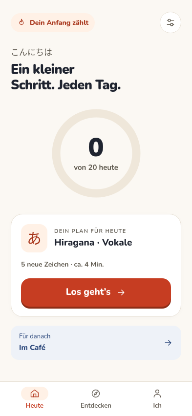
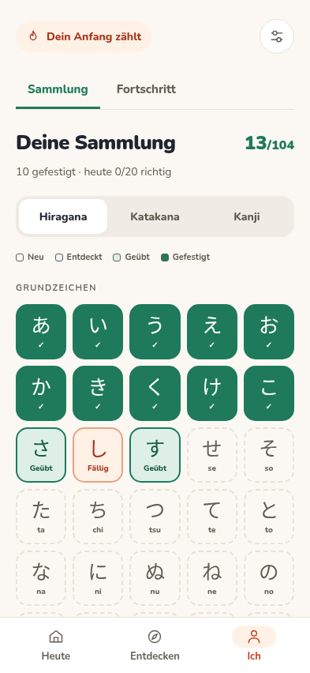
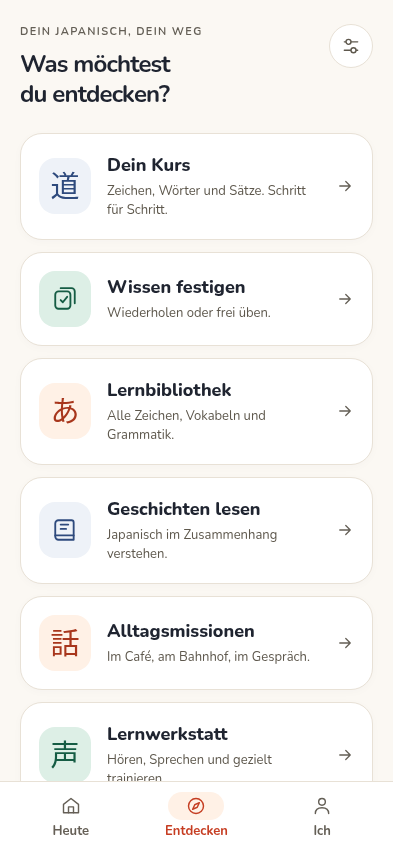
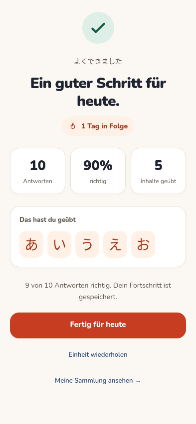

# Redesign A + C · Version 1.2.0

Umsetzung der vom Nutzer gewählten Mischung aus `redesign-varianten.html`: ein klarer Lernstart aus A und die persönliche Zeichensammlung aus C.

| Bereich   | Aufgabe                                                                                |
| --------- | -------------------------------------------------------------------------------------- |
| Heute     | Lernserie, Tagesring, genau ein empfohlener Lernstart; begonnene Einheiten fortsetzen. |
| Entdecken | Kurs, Üben, Bibliothek, Geschichten, Missionen, Werkstatt und Lernheft.                |
| Ich       | Zeichensammlung und bisherige Fortschrittsauswertung.                                  |

Der tägliche Knopf beschreibt und startet dieselbe Aktivität. Er verspricht keine neuen Zeichen zusätzlich zu einer reinen Wiederholung. Die Sammlung spiegelt vorhandene SRS-Daten wider: eingeführt, mindestens einmal richtig abgerufen, gefestigt. Grün ist an mindestens sieben Tage Wiederholungsabstand gebunden; Orange markiert fällige oder als Nächstes empfohlene Inhalte. Es werden keine Beispielleistungen in den produktiven Lernstand geschrieben.

## Ansichten

Die Screenshots stammen aus der laufenden App in Chromium bei 393 × 852. Start und Entdecken verwenden einen frischen Lernstand. Die Sammlung verwendet Testdaten, um die verschiedenen Zustände sichtbar zu machen; der Abschluss stammt aus einer vollständig durchgespielten Lektion mit neun richtigen Antworten bei zehn Versuchen.

| Heute                                                               | Sammlung                                                                                       |
| ------------------------------------------------------------------- | ---------------------------------------------------------------------------------------------- |
|  |  |

| Entdecken                                                              | Abschluss                                                                                     |
| ---------------------------------------------------------------------- | --------------------------------------------------------------------------------------------- |
|  |  |

## Schrift und Offlinebetrieb

Nunito wird lokal ausgeliefert, ohne Anfrage an Google Fonts. Quelle: `@fontsource-variable/nunito` 5.3.0; Lizenz: [SIL Open Font License](../public/fonts/Nunito-LICENSE.txt). Japanische Zeichen verwenden die japanische Systemschrift. Die PWA speichert die lokalen Schriftdateien für den Offlinebetrieb.

[Prüfumfang und Umsetzungsstand](IMPLEMENTATION_STATUS.md)
